# mcpx_template_project 项目介绍

> 版本：v1.0.0 ｜ 更新：2026-11-19
> 项目类型：WPF 桌面工业上位机（PLC Base）
> 技术栈：C# / WPF / .NET 8 / CommunityToolkit.Mvvm / EF Core(SQLite) / McpX（三菱 Q 系列 MC 协议）
> 适用场景：半导体 / PCB 等自动化设备的 PLC**（三菱 Q系列）** 通讯、SECS/GEM 通讯

---

## 目录

- [1. 项目概述](#1-项目概述)
- [2. 技术选型](#2-技术选型)
  - [2.1 运行时与框架](#21-运行时与框架)
  - [2.2 数据与持久层](#22-数据与持久层)
  - [2.3 通讯协议](#23-通讯协议)
  - [2.4 横切与辅助](#24-横切与辅助)
- [3. 系统功能](#3-系统功能)
  - [3.1 系统管理（Admin）](#31-系统管理admin)
    - [3.1.1 登录页](#311-登录页账号admin-密码1)
    - [3.1.2 系统管理](#312-系统管理)
    - [3.1.3 日志管理](#313-日志管理)
  - [3.2 业务功能（Business）](#32-业务功能business)
  - [3.3 核心通讯能力](#33-核心通讯能力)
    - [3.3.1 PLC 通讯模块功能](#331-plc-通讯模块功能)
    - [3.3.2 SECS/GEM 通讯模块功能](#332-secsgem-通讯模块功能)
- [4. 环境部署](#4-环境部署)
  - [4.1 前置要求](#41-前置要求)
  - [4.2 获取与还原](#42-获取与还原)
  - [4.3 运行](#43-运行)
  - [4.4 发布](#44-发布)
  - [4.5 配置说明](#45-配置说明resoucesappsettingsjson)
  - [4.6 首次启动](#46-首次启动)
- [5. 文件结构](#5-文件结构)
- [6. 分层架构](#6-分层架构)
- [7. 关键设计原则](#7-关键设计原则)
- [8. 相关文档](#8-相关文档)

---

## 1. 项目概述

`mcpx_template_project` 是一套基于 **C# / WPF / .NET 8** 的工业设备上位机（EQP，Equipment）软件，主要解决三类问题：

| 能力              | 说明                                                         |
| ----------------- | ------------------------------------------------------------ |
| **PLC 通讯**      | 通过三菱 MC 协议（McpX）读写设备点位（D/W/M/X/Y… 软元件），支持批量读、单点写、连接管理 |
| **SECS/GEM 通讯** | 以 Equipment/Passive 端角色，通过 HSMS 与 MES/Host 上位机通讯，覆盖 S1/S2/S5/S6/S7/S10 核心消息 |
| **业务管理**      | 配方（Recipe）管理、警报/事件统一触发器、用户权限、日志、看板监控等 |

软件内置「注解驱动」开发模型：业务开发者只需在实体属性上打 `[PlcRead]` / `[PlcWrite]` / `[SecsStream]` / `[SecsFunction]` 等特性，底层框架自动完成点位扫描、报文编解码、消息路由与握手，无需编写通讯样板代码。

---

## 2. 技术选型

### 2.1 运行时与框架

| 类别     | 选型                                              | 版本                         | 说明                          |
| -------- | ------------------------------------------------- | ---------------------------- | ----------------------------- |
| 语言     | C#                                                | 12                           | —                             |
| 目标框架 | .NET                                              | `net8.0-windows10.0.19041.0` | Win10 2004 及以上             |
| UI       | WPF                                               | —                            | `WinExe` 桌面应用             |
| UI 主题  | iNKORE.UI.WPF.Modern                              | 0.10.2.1                     | Fluent 现代化界面             |
| MVVM     | CommunityToolkit.Mvvm                             | 8.4.2                        | 命令、消息、可观察对象        |
| 依赖注入 | Microsoft.Extensions.DependencyInjection          | 8.0                          | 全局 IOC 容器                 |
| 配置     | Microsoft.Extensions.Configuration(.Json/.Binder) | 8.0                          | `appsettings.json` 强类型绑定 |

### 2.2 数据与持久层

| 类别   | 选型                           | 版本  | 说明                                       |
| ------ | ------------------------------ | ----- | ------------------------------------------ |
| ORM    | Entity Framework Core          | 8.0.8 | Code First + `IDbContextFactory`           |
| 数据库 | SQLite                         | 8.0.8 | 单文件本地库，`Microsoft.Data.Sqlite` 驱动 |
| 建表   | DatabaseInitializer + SQL 脚本 | —     | 启动自动建表 + 种子数据                    |

### 2.3 通讯协议

| 类别     | 选型                    | 版本  | 说明                                       |
| -------- | ----------------------- | ----- | ------------------------------------------ |
| PLC 通讯 | McpX                    | 0.9.1 | 三菱 Q 系列 MC 协议（3E/4E、二进制/ASCII） |
| SECS/GEM | Secs4Net + Secs4Net.Sml | 3.1.0 | HSMS-SS Passive 端，SML 报文解析           |

### 2.4 横切与辅助

| 类别     | 选型                                         | 版本                  | 说明                      |
| -------- | -------------------------------------------- | --------------------- | ------------------------- |
| 日志     | Serilog (+Sinks.File/Settings.Configuration) | 4.4.0                 | 控制台 + 按日滚动文件     |
| AOP      | Fody + MethodBoundaryAspect.Fody             | 6.9.3 / 2.0.150       | 方法级日志切面            |
| 密码     | BCrypt.Net-Next                              | 4.2.0                 | 密码哈希                  |
| 图表     | ScottPlot                                    | 5.1.59                | 看板图表                  |
| Office   | NPOI / EPPlus**（商用需付费）** / DocX       | 2.8.0 / 8.6.3 / 5.2.0 | Excel 导入导出、Word 导出 |
| 3D       | OpenTK.GLWpfControl                          | 4.3.6                 | OpenGL 控件               |
| 系统信息 | System.Management                            | 8.0.0                 | 硬件信息采集              |
| GIF      | XamlAnimatedGif                              | —                     | 动画资源（本地 dll 引用） |

---

## 3. 系统功能

### 3.1 系统管理（Admin）

| 模块     | 页面             | 说明                                                         |
| -------- | ---------------- | ------------------------------------------------------------ |
| 登录     | `Login`          | 账号密码登录，BCrypt 校验，含授权校验（LicenseCheck，提供了基本的工具接口不可直接用于生产） |
| 用户管理 | `PageUser`       | 用户 CRUD、分配角色/岗位                                     |
| 角色管理 | `PageRole`       | 角色 CRUD、菜单权限分配                                      |
| 菜单管理 | `PageMenu`       | 菜单/路由/权限点维护，树形结构                               |
| 部门管理 | `PageDept`       | 部门树 CRUD                                                  |
| 岗位管理 | `PagePost`       | 岗位 CRUD                                                    |
| 字典管理 | 字典数据         | 数据字典维护                                                 |
| 通知公告 | `PageNotice`     | 公告发布、已读状态                                           |
| 操作日志 | `PageOperLog`    | 操作日志查询、详情                                           |
| 个人中心 | `PageUserCenter` | 个人资料、密码修改                                           |

> 权限模型：`用户 - 角色 - 菜单` 三级 RBAC，实现按钮/菜单级权限控制。

#### 系统基本功能介绍

##### 3.1.1 登录页（账号：admin 密码：1）


##### 3.1.2 系统管理

此部分在应用层面大量参考[若依](https://doc.ruoyi.vip/ruoyi/)，不过多赘述；因本项目为单机桌面应用，未完全实现（如 Security 部分）。菜单管理输入完整限定名，直接加载组件，不再做路径拼接；可用 icon 请参考 [iNKORE 官网](https://www.inkore.net/)或在微软商店下载 iNKORE.UI.WPF.Modern Gallery，具体可用 icon 需查看 `mcpx_template_project.Tools.SegoeFluentIconsDump`。

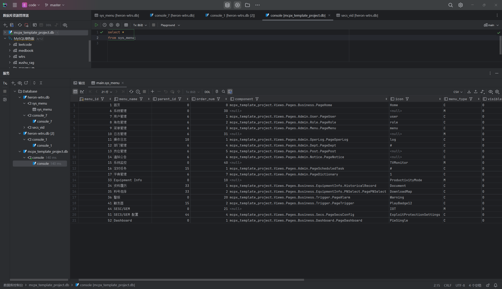

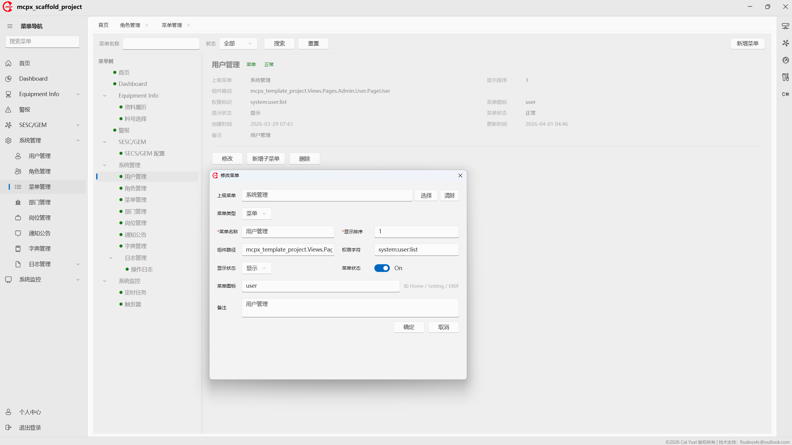

##### 3.1.3 日志管理

基于 Fody AOP 实现，使用范例如下：

```csharp
[Log(Title = "用户登录", BusinessType = BusinessType.Grant)]
public async Task<ApiResult<SysUser>> LoginAsync(string userName, string password)
{
    // ...
}
```

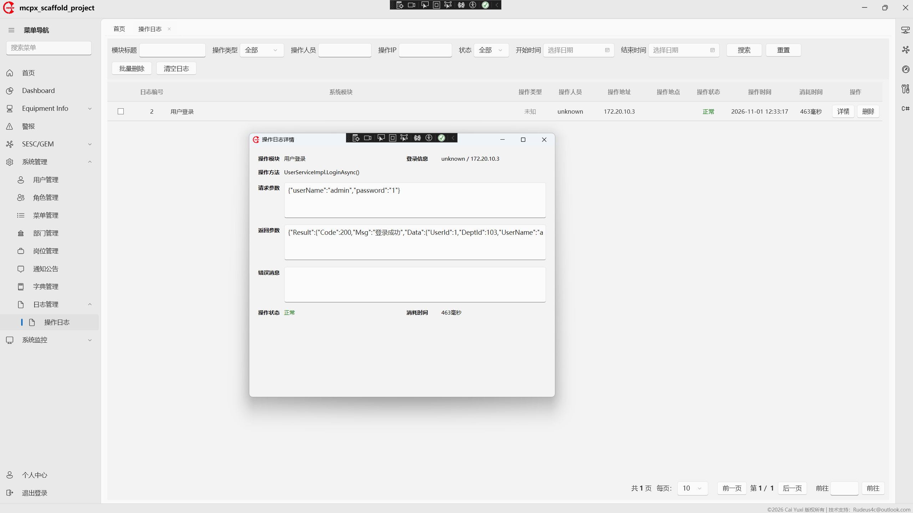

### 3.2 业务功能（Business）

- **首页** `PageHome` — 系统首页导航
- **看板** `PageDashboard` — 数据看板（ScottPlot 图表）
- **通讯设置** `CommSettingWindow` — PLC 通讯参数配置（IP/端口/帧类型/点位区域）
- **PLC 监控** `PlcMonitorWindow` — 点位实时监控、读写调试
- **配方管理** `PagePNSelect` — 配方 CRUD + 「写入配方」下发 PLC（含三态握手）
- **警报** `PageAlarm` — 实时展示正在发生的警报，弹窗 + 声音 + 角标
- **触发器** `PageTrigger` — 警报/事件统一触发器配置，Excel 导入导出
- **SECS 配置** `PageSecsConfig` — VID/Report/CEID/SxFy 权限/HCMD 配置
- **SECS/GEM** `SecsGemSettingWindow` — HSMS 监听参数、连接状态、多实例管理

##### 界面预览

- **首页**：`docs/imgs/Home.png`
- **看板**：`docs/imgs/Dashborad.png`
- **配方管理**：`docs/imgs/ppselect.png`
- **警报**：`docs/imgs/Alarm.png`

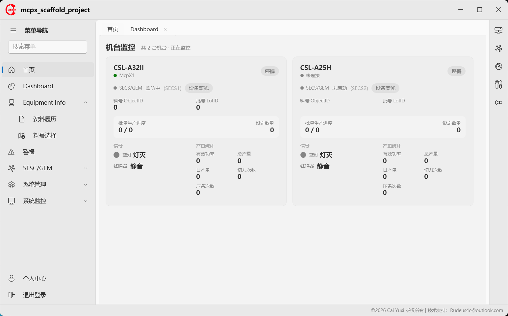

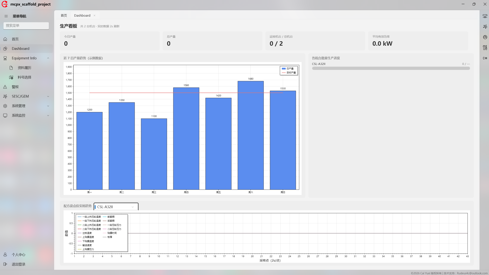

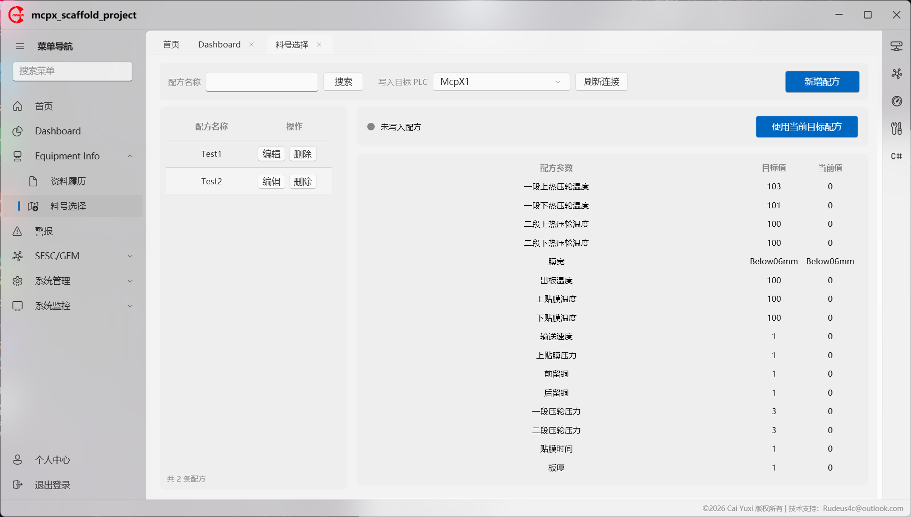

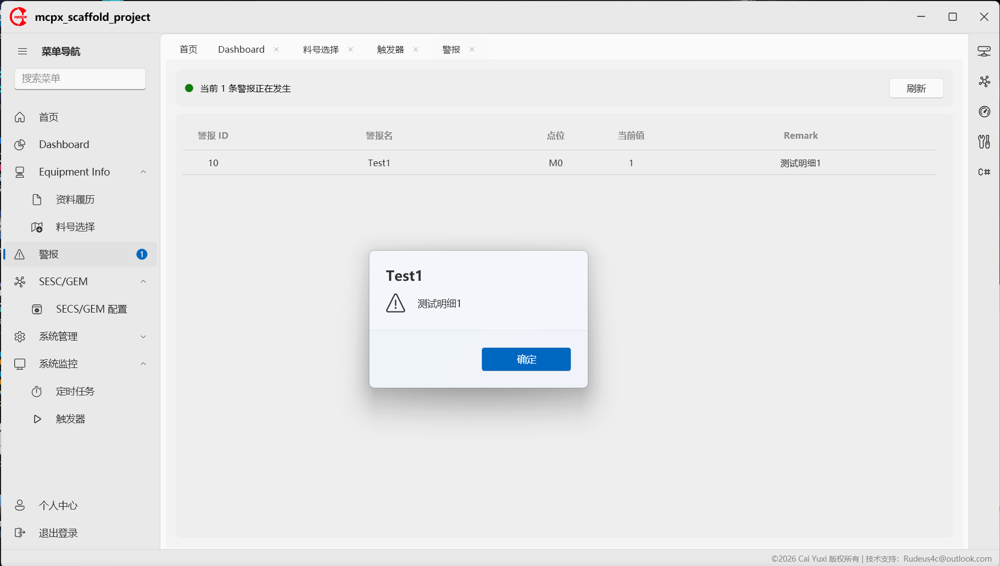

### 3.3 核心通讯能力

**PLC（三菱 MC 协议）**

- 批量读取点位并缓存，周期刷新；单点写入。
- 帧类型/通信格式自动探测（3E 二进制 → 4E 二进制 → 3E ASCII → 4E ASCII）。
- DEBUG 下注入 `MockPlcCommunicationService`，无需真实 PLC 即可联调。

**SECS/GEM（HSMS Passive）**

- Equipment 端被动监听，Host 主动连接后双向建立通信（S1F13/S1F14）。
- 注解路由 `[SecsStream]`+`[SecsFunction]`，支持 S1/S2/S5/S6/S7/S10 与 S9 错误。
- 多设备管理器 `ISecsGemManager`，按 deviceKey 隔离引擎与状态（E30 Control State）。
- VID 双源取值：`db` 固定值 / `plc` 点位缓存，PLC 采集 → SECS 上报。

**警报与事件**

- 统一 `plc_trigger` 表，`trigger_type`（alarm/event）+ `trigger_mode`（on/change）驱动。
- 事件处理器方法级注解 `[PlcEvent]` + `IPlcEventHost` 标记接口，启动扫描注册，反射调用。

#### 3.3.1 PLC 通讯模块功能

##### 通讯设定模块

项目支持读写多 PLC 设备实例：配置 PLC 通讯信息，并配置读写区域。架构设计请参阅 [plc-framework.md](./docs/plc-framework.md)。

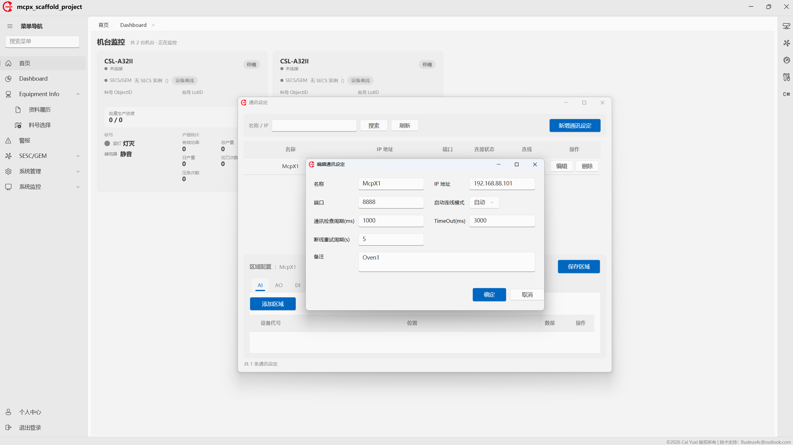

> 启动连线模式：自动 - 在用户登录后自动建立连接。
>
> AI/AO/DI/DO：在本项目中未实际作用，设计之初考虑到不同品牌、不同型号 PLC 设备代号不同而引入作为中间层解耦，使开发者无需关注各 PLC 设备代号定义；目前仅支持三菱 PLC Q 系列，故仅作为概念存在。

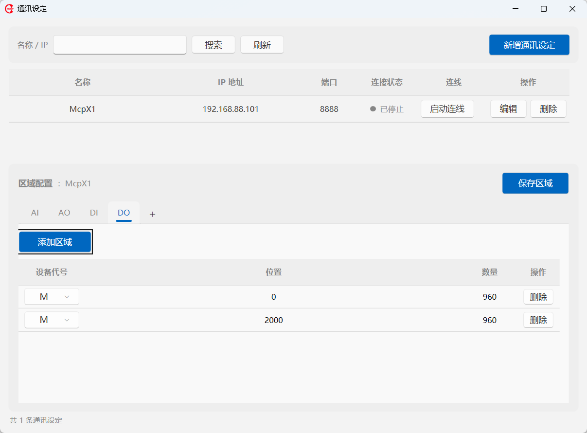

##### 实时监控模块：辅助开发者读/写 PLC 进行调试

左上方为通讯设定的全部读点位，左下方为注解业务点位（被区域点位包含，独立显示方便开发者调试）。

右侧可对 PLC 实时读写调试。

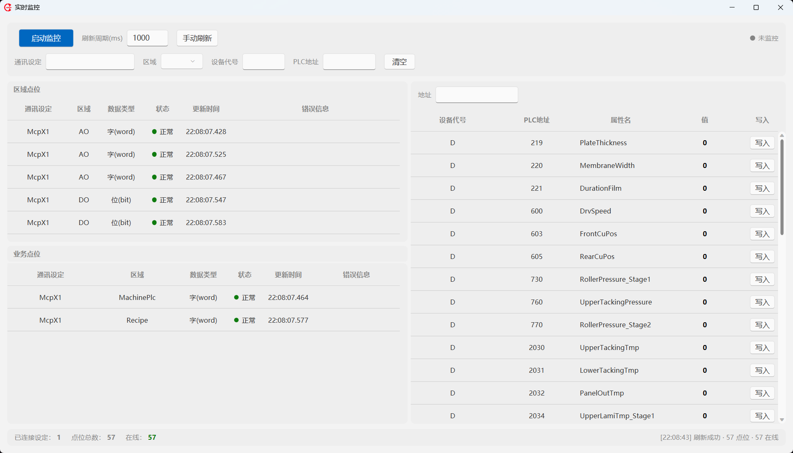

##### 触发器

该模块包含两个业务模块：事件和警报。由于事件与警报在交接层本质一致，故整合为统一触发器。使用方式如下：

1. 实现 `IPlcEventHost` 标记接口，并在任意方法上打 `[PlcEvent]` 注解（方法级，返回类型必须为 `Task`，可选 `PlcEventContext` 首参）。

   ```csharp
   /// <summary>
   /// 示例事件宿主：演示方法级 [PlcEvent] 注解的用法。
   /// 实现 IPlcEventHost 标记接口，方法打 [PlcEvent] 即可被触发器配点界面下拉框选中，
   /// 点位值变化时被反射调用。一个宿主类可承载多个动作，无需为每个动作新建类。
   /// </summary>
   /// <author>Rudeus</author>
   public class LogPlcEventHandler : IPlcEventHost
   {
       private readonly ILogService _logService;

       public LogPlcEventHandler(ILogService logService)
       {
           _logService = logService;
       }

       /// <summary>写操作日志：点位值变化时记录一条日志。</summary>
       [PlcEvent("log_event", "写入操作日志", Description = "触发时记录一条日志")]
       public Task LogEvent(PlcEventContext ctx)
       {
           _logService.LogInformation(
               "[PLC事件] {Name} 触发：点位 {Address}，当前值 {Value}，时间 {Time}",
               ctx.Name, ctx.FullAddress, ctx.CurrentValue, ctx.TriggerTime);

           return Task.CompletedTask;
       }

       /// <summary>示例二：无参方法同样可被选中（不接收上下文）。</summary>
       [PlcEvent("log_event_simple", "写入日志(无参)", Description = "无参方法示例")]
       public Task LogEventSimple()
       {
           _logService.LogInformation("[PLC事件] 无参事件处理器被触发");
           return Task.CompletedTask;
       }
   }
   ```

2. 启动项目即可配置事件处理方法

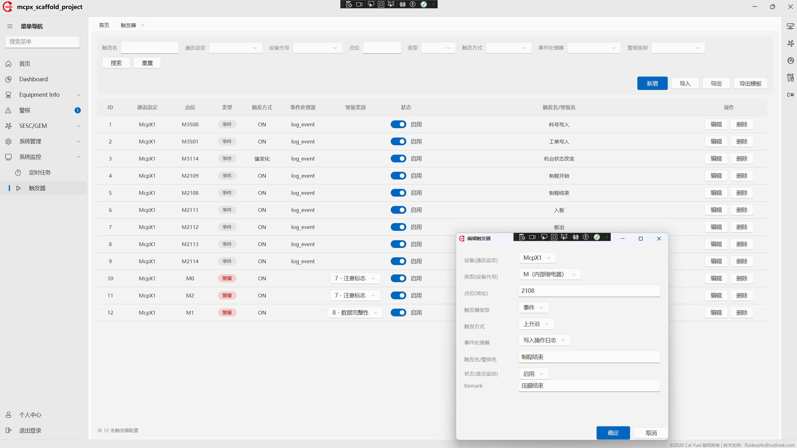

##### 面向对象式读写 PLC（项目核心设计）

详细请参阅 [plc-framework.md](./docs/plc-framework.md)。

#### 3.3.2 SECS/GEM 通讯模块功能

本项目支持多 SECS/GEM 实例，一个 SECS/GEM 实例仅对应一台设备。

##### 通讯设定

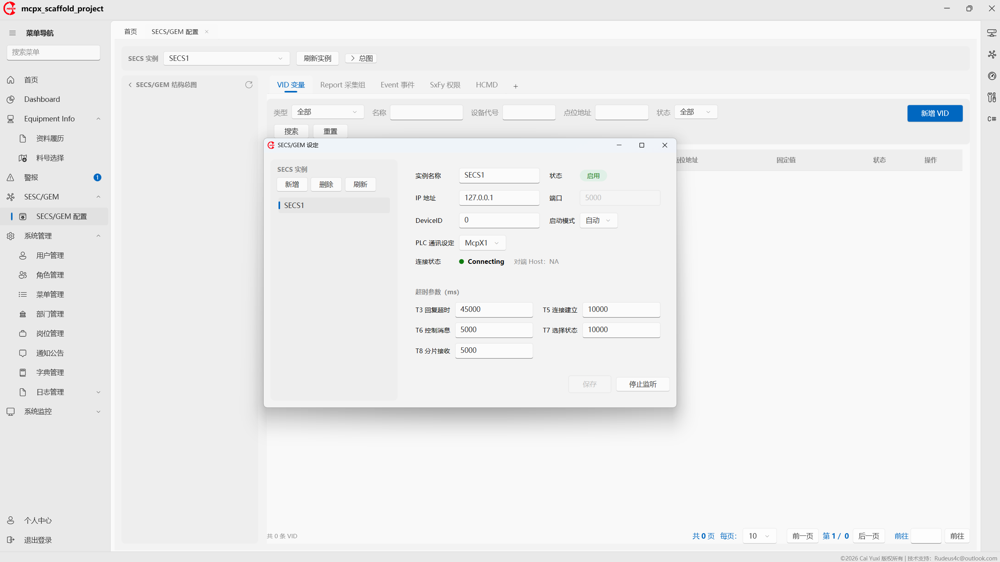

##### SxFy 配置

控制层打 `[SecsPermission]` 即可做前置增强，在配置界面设定可执行的状态，即可在方法执行前获取当前连线状态并判断是否有权限执行。详见 [secs-gem-framework.md](./docs/secs-gem-framework.md)。使用范例如下：

```csharp
/// <summary>S1F3</summary>
[SecsFunction(3)]
[SecsPermission]
public async Task<SecsMessage?> S1F3(SecsMessage primaryMsg, CancellationToken ct)
{
    // 零长度列表表示查询全部
    var data = primaryMsg.SecsItem;
    if (data != null && data.Format != SecsFormat.List)
        return null; // 结构非法 → 由调用方回 S9F7

    var svids = ParseU4List(data);

    var values = await _statusService.GetStatusValuesAsync(InstanceId, svids);

    // S1F4 结构：L,n [SV...]，不存在用空列表项占位
    var items = values.Select(v => v.Exists && v.Value != null ? v.Value! : Item.L()).ToArray();
    return new SecsMessage(1, 4, replyExpected: false)
    {
        Name = "SelectedEquipmentStatusData",
        SecsItem = Item.L(items)
    };
}
```

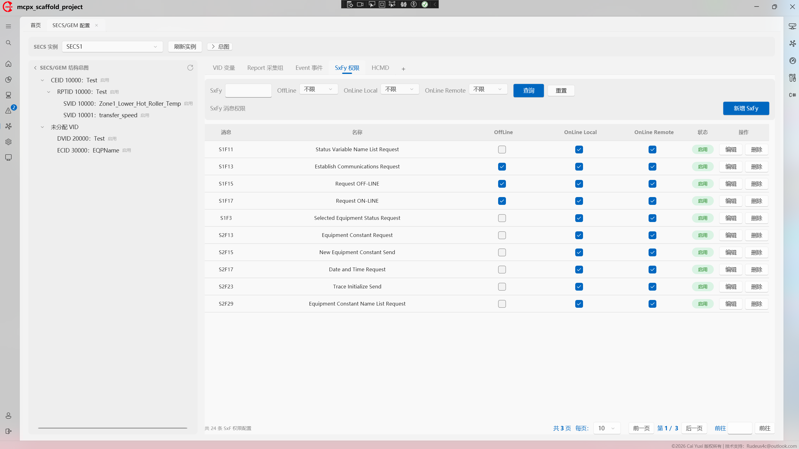

##### VID 配置

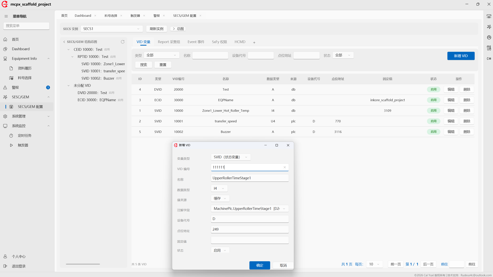

##### HCMD 配置

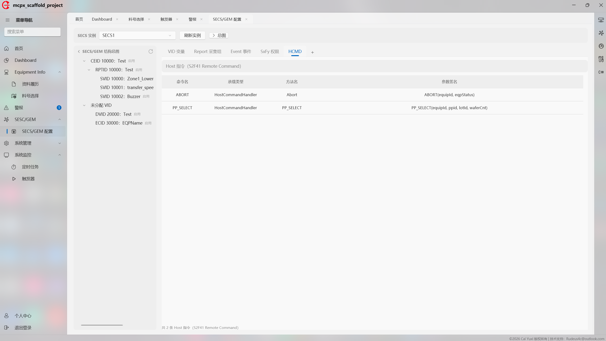

---

## 4. 环境部署

### 4.1 前置要求

| 项       | 要求                                                         |
| -------- | ------------------------------------------------------------ |
| 操作系统 | Windows 10 19041（2004）及以上 / Windows 11                  |
| .NET SDK | .NET 8.0 SDK（含 `net8.0-windows` 工作负载）                 |
| IDE      | Visual Studio 2022（17.8+，含「.NET 桌面开发」工作负载）或 `dotnet` CLI |
| 其他     | 首次构建需联网还原 NuGet 包                                  |

### 4.2 获取与还原

```bash
# 1. 进入解决方案目录
cd D:\code\C#\mcpx_template_project

# 2. 还原 NuGet 依赖
dotnet restore mcpx_template_project.sln

# 3. 构建（Debug）
dotnet build mcpx_template_project.sln -c Debug
```

> `Libs\XamlAnimatedGif.dll` 为本地引用，需保留 `Libs` 目录。

### 4.3 运行

```bash
# 直接运行（Debug）
dotnet run --project mcpx_template_project\mcpx_template_project.csproj
```

或在 Visual Studio 中：打开 `mcpx_template_project.sln` → 设置 `mcpx_template_project` 为启动项目 → F5。

### 4.4 发布

发布后需保证以下文件随程序分发（`.csproj` 已配置 `CopyToOutputDirectory`）：

- `resouces\appsettings.json`（配置）
- `resouces\Sql\*.sql`（建表脚本）
- `resouces\csunresource\**`（FastCSUN所需的资源，因`PrintFiles.vbs`为对接打印机功能所保留）

### 4.5 配置说明（`resouces/appsettings.json`）

```jsonc
{
  "ConnectionStrings": {
    "SqliteDb": "Data Source=|DataDirectory|\\mcpx_template_project.db"   // SQLite 库文件
  },
  "SecsGem": {          // SECS/GEM 默认监听参数，以数据库配置优先
    "IpAddress": "0.0.0.0",
    "Port": 5000,
    "DeviceId": 0,
    "ConnectMode": "manual",
    "T3": 45000, "T5": 10000, "T6": 5000, "T7": 10000, "T8": 5000
  },
  "Serilog": { /* 日志配置：控制台 + logs/log-*.txt 按日滚动 */ }
}
```

### 4.6 首次启动

1. 启动后自动执行 `DatabaseInitializer.Initialize`：按 `resouces/Sql` 脚本建表并写入种子数据（含默认管理员账号（admin，1）、菜单）。
2. 弹出登录窗口，登录成功后进入主界面。
3. 在「通讯设置」配置 PLC 参数；在「SECS/GEM 设置」配置监听并启动。
4. DEBUG 构建下 PLC 通讯走 Mock 实现，可离线验证完整业务流程。

---

## 5. 文件结构

```
mcpx_template_project.sln
docs/                                  # 设计文档
  ├─ plc-framework.md                  # PLC 通讯框架设计（含警报/事件触发器）
  ├─ secs-gem-framework.md             # SECS/GEM 通讯框架设计
  ├─ imgs/                             # 文档截图
  └─ uml/                              # PlantUML / Mermaid 图
mcpx_template_project/               # 主项目
  ├─ App.xaml(.cs)                     # 入口：加载配置→注册DI→建表→登录
  ├─ MainWindow.xaml(.cs)              # 主窗口
  ├─ Assets/                           # 图片/图标资源
  ├─ Configation/                      # 配置与数据层初始化
  │   ├─ AppConfiguration.cs           # 配置加载
  │   ├─ EFDbContext.cs                # EF Core 上下文
  │   └─ DatabaseInitializer.cs        # 建表 + 种子数据
  ├─ Converters/                       # XAML 值转换器
  ├─ Core/                             # 核心抽象（无 UI 依赖）
  │   ├─ Logging/                      # 日志服务接口/实现
  │   ├─ Plc/                          # PlcFieldCatalog / PlcPointAccessor
  │   ├─ Scanner/                      # PlcPointAttributeScanner 注解扫描
  │   ├─ Context/                      # ISecsContext（AsyncLocal）
  │   ├─ Handler/                      # IPlcEventHost
  │   └─ SecsRoute/                    # SecsRouter / SecsRoute / HcmdRegistry
  ├─ Controller/SecsGem/               # S1~S10 消息控制器 + S9 错误工厂
  ├─ DependencyInjection/              # DI 注册（Service/View/Db/Config/Admin/Business）
  ├─ Domain/                           # 领域层
  │   ├─ Enums/                        # 枚举（PlcDevice/PlcWriteRole/SecsControlState…）
  │   ├─ Entities/
  │   │   ├─ System/                   # SysUser/SysRole/SysMenu/SysDept/SysPost/SysDictData/SysNotice/SysOperLog
  │   │   └─ Business/                 # CommSetting/Secs*/Machine/Recipe/PlcTrigger
  │   ├─ Model/                        # Plc / Secs 领域模型
  │   └─ VO/                           # 视图对象
  ├─ Helper/                           # 工具类（Excel/AES/硬件ID/PLC地址…）
  ├─ Service/
  │   ├─ Admin/                        # 认证/用户/角色/菜单/部门/岗位/公告/日志/授权
  │   └─ Business/                     # CommSetting/Plc/Recipe/Secs/Machine/Trigger
  ├─ ViewModels/                       # MVVM 视图模型
  │   ├─ Admin/
  │   ├─ Business/
  │   └─ Common/                       # PagedViewModelBase / RelayCommand
  ├─ Views/Pages/
  │   ├─ Admin/                        # Login/User/Role/Menu/Dept/Post/Notice/OperLog/UserCenter
  │   └─ Business/                     # Home/Dashboard/CommSetting/PNSelect/Trigger/Secs/SecsGem/Monitor
  ├─ resouces/
  │   ├─ Sql/                          # 建表 + 种子 SQL（*.sql）
  │   ├─ csunresource/                 # 订单/估算模板资源（可直接删除）
  │   ├─ appsettings.json              # 全局配置
  │   └─ FodyWeavers.xml               # AOP 织入配置
  └─ Libs/                             # 本地第三方 dll（XamlAnimatedGif）
```

> 删除Business下文件，可作为桌面后台权限系统模板使用。

---

## 6. 分层架构

```
┌─────────────────────────────────────────────────────────┐
│ 表示层  ViewModels / Views（WPF + iNKORE 主题 + MVVM）    │
├─────────────────────────────────────────────────────────┤
│ 控制器层 Controller/SecsGem（[SecsStream]/[SecsFunction]）│
├─────────────────────────────────────────────────────────┤
│ 服务层   Service/Admin + Service/Business（业务逻辑）      │
├─────────────────────────────────────────────────────────┤
│ 核心层   Core（注解扫描/路由/访问器/上下文）               │
├─────────────────────────────────────────────────────────┤
│ 领域层   Domain（实体/枚举/模型/VO）                      │
├─────────────────────────────────────────────────────────┤
│ 通讯引擎 McpX（PLC） + Secs4Net（SECS/GEM）               │
├─────────────────────────────────────────────────────────┤
│ 持久层   EF Core + SQLite（本地单文件库）                  │
└─────────────────────────────────────────────────────────┘
```

---

## 7. 关键设计原则

1. **注解驱动，零样板**：PLC 读写走 `[PlcRead]/[PlcWrite]`，SECS 路由走 `[SecsStream]/[SecsFunction]`。
2. **读写分离**：PLC 读/写注解职责清晰，写点位用 `PlcWriteRole`（Value/Trigger/Reply）自动分类。
3. **类型安全**：设备代号用 `PlcDevice` 枚举，杜绝魔法字符串。
4. **可测试**：`IPlcCommunicationService` 抽象出真实/Mock 双实现，`#if DEBUG` 自动切换。
5. **数据表驱动**：SECS VID/Report/CEID/SxFy 全部落库，运行期可视化配置。
6. **多实例隔离**：`ISecsGemManager` + `Func` 工厂 + `ISecsContext`（AsyncLocal）支持多设备并发。
7. **性能**：反射扫描结果缓存 + 表达式树编译 getter，运行期零反射。

---

## 8. 相关文档

| 文档                  | 路径                         |
| --------------------- | ---------------------------- |
| PLC 通讯框架设计      | `docs/plc-framework.md`      |
| SECS/GEM 通讯框架设计 | `docs/secs-gem-framework.md` |
