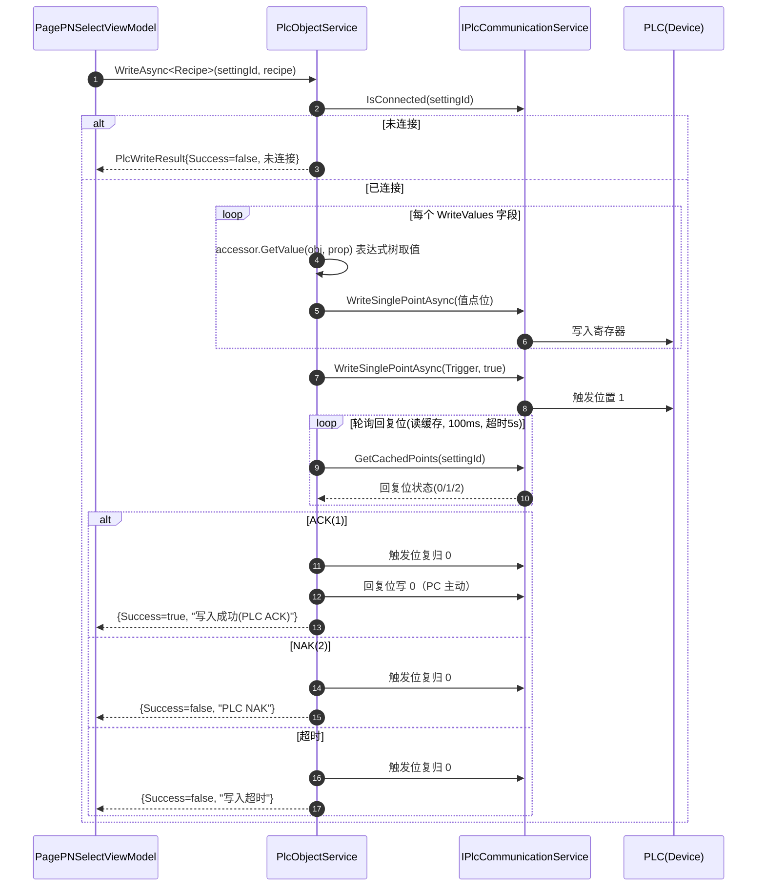
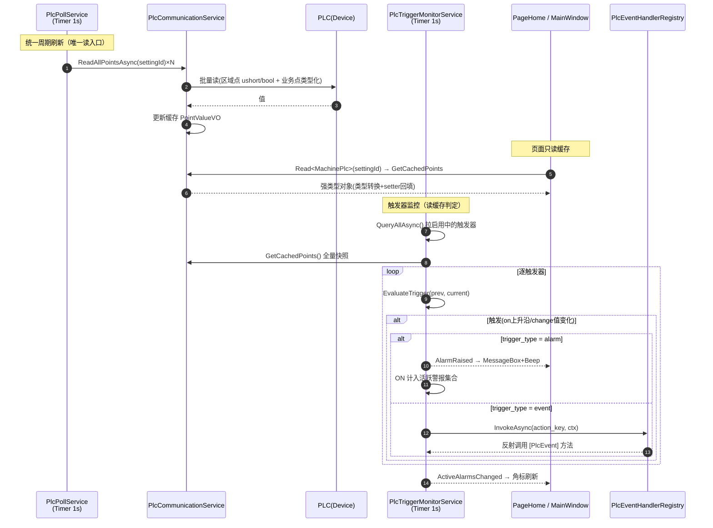
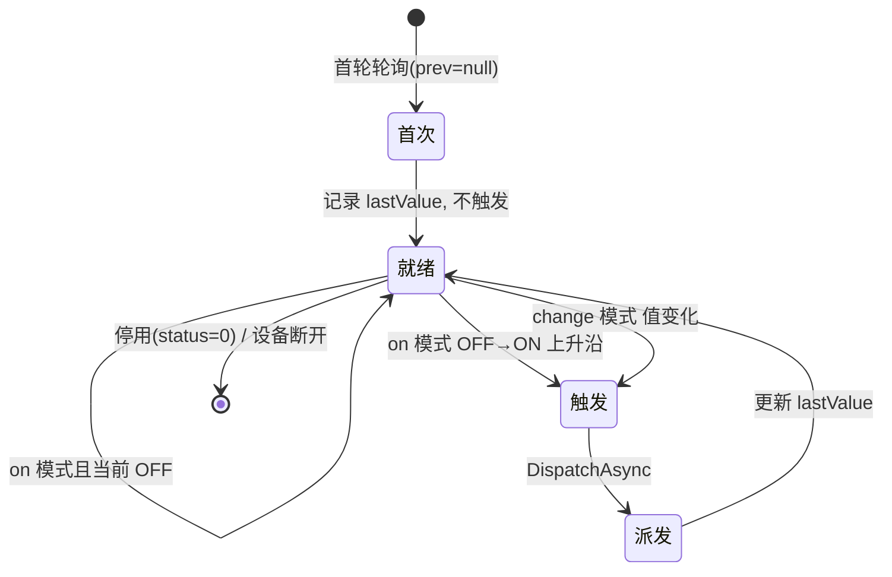
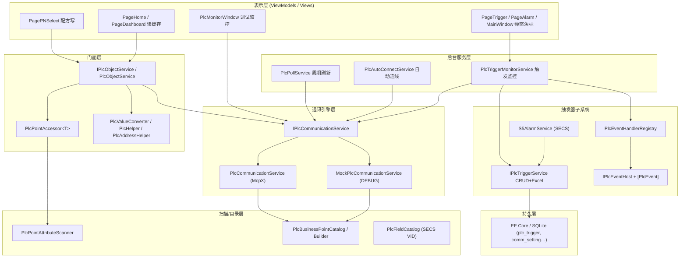

# PLC 通讯与触发器框架设计文档

> 版本：v1.0（读写注解分离 + 通用对象门面）
> 项目：mcpx_template_project
> 技术栈：C# / WPF / .NET 8 / CommunityToolkit.Mvvm / EF Core(SQLite) / McpX（三菱 Q 系列 MC 协议）

---

## 1. 设计目标与核心理念

本项目将PLC 点位读写从通讯细节中彻底抽象出来，让开发者**像写 ORM 一样**操作 PLC：

```csharp
// 写：给对象属性赋值（实体已打注解），底层自动完成：扫描注解 → 分类点位 → 握手 → 下发
recipe.UpperLamiTmp_Stage1 = 120;
recipe.DrvSpeed = 3.5;
var result = await _plcObjectService.WriteAsync<Recipe>(settingId, recipe);

// 读：拿回一个已填好当前值的强类型对象
var current = _plcObjectService.Read<Recipe>(settingId);
var power   = _plcObjectService.Read<MachinePlc>(settingId).EffectivePower;
```

### 核心理念

| 维度 | 当前方案 |
| --- | --- |
| 注解模型 | **读/写分离**：`[PlcRead]` + `[PlcWrite]`（角色由 `PlcWriteRole` 区分） |
| 设备代号 | **枚举** `PlcDevice.D` / `PlcDevice.M`，杜绝魔法字符串 |
| 点位分类 | 扫描器自动分类为 `PlcObjectPlan`（Reads / WriteValues / Trigger / Reply） |
| 读写入口 | **通用门面** `IPlcObjectService`（`Read<T>` 返回强类型对象） |
| 取值加速 | 表达式树编译 getter/setter，运行期零反射 |
| 读 PLC 原则 | **全应用唯一读入口** `ReadAllPointsAsync`，周期刷新缓存，其余全部读缓存 |
| 业务点位 | 连接时由 `PlcBusinessPointCatalog` 自动注入缓存（含类型化读取） |
| 写握手 | **三态握手**（0=处理中 / 1=ACK / 2=NAK），触发位/回复位复归由 PC 主动完成 |
| 警报/事件 | **统一触发器表 `plc_trigger`**，`trigger_type` 区分，共享同一套「读缓存 → 判定 → 派发」引擎 |
| 事件处理器 | **方法级注解** `[PlcEvent]` + 标记接口 `IPlcEventHost`，注册表扫描登记、反射调用 |
| 可测试 | `IPlcCommunicationService` 真实/Mock 双实现，`#if DEBUG` 自动切换 |

---

## 2. 总体分层架构

```
┌──────────────────────────────────────────────────────────────────────┐
│ 业务实体层（Recipe / MachinePlc …，打 [PlcRead] / [PlcWrite] 注解）      │
│ 触发器配置（plc_trigger 表，PageTrigger 界面维护）                       │
└──────────────────────────┬───────────────────────────────────────────┘
                           │ 反射扫描（启动一次，ConcurrentDictionary 缓存）
┌──────────────────────────▼───────────────────────────────────────────┐
│ 扫描/访问层  Core/Scanner/PlcPointAttributeScanner → PlcObjectPlan     │
│             Core/Plc/PlcPointAccessor<T>（表达式树 getter/setter）      │
│             Core/Plc/PlcBusinessPointCatalog（业务点位目录）             │
└──────────────────────────┬───────────────────────────────────────────┘
                           │
┌──────────────────────────▼───────────────────────────────────────────┐
│ 通用门面层  IPlcObjectService / PlcObjectService                      │
│   WriteAsync<T>（三态握手）/ Read<T>（强类型）/ IsConnected              │
│   辅助：PlcValueConverter（字符串↔CLR类型）/ PlcHelper / PlcAddressHelper │
└──────────────────────────┬───────────────────────────────────────────┘
                           │ WriteSinglePointAsync / GetCachedPoints / ReadAllPointsAsync
┌──────────────────────────▼───────────────────────────────────────────┐
│ 通讯引擎层  IPlcCommunicationService                                   │
│   ├─ PlcCommunicationService（真实，McpX 三菱Q系列，3E/4E×二进制/ASCII）  │
│   └─ MockPlcCommunicationService（DEBUG 模拟，地址值表唯一真源）          │
│   连接时注入业务点位：PlcBusinessPointBuilder → PointValueVO             │
└──────────────────────────┬───────────────────────────────────────────┘
                           │ 周期调用（1s）
┌──────────────────────────▼───────────────────────────────────────────┐
│ 后台服务层                                                             │
│   ├─ PlcPollService：周期调用唯一读入口刷新缓存（所有页面的数据源）  │
│   ├─ PlcAutoConnectService：登录后自动连接 ConnectMode=auto 的设定       │
│   └─ PlcTriggerMonitorService：触发器监控（警报弹窗 / 事件派发）           │
└──────────────────────────────────────────────────────────────────────┘
```

---

## 3. 三条关键数据链路总览

| 链路 | 入口 | 流向 |
| --- | --- | --- |
| **写链路**（配方下发） | 用户点「写入配方」 | VM → `WriteAsync<T>` → 逐字段下发 → 触发位置 1 → 轮询回复位 → 双双复归 0 |
| **读链路**（监控展示） | `PlcPollService` 1s 周期 | Timer → `ReadAllPointsAsync`（唯一读入口，区域点+业务点全量刷缓存）→ 各页面 `Read<T>` / `GetCachedPoints` 只读缓存 |
| **触发链路**（警报/事件） | `PlcTriggerMonitorService` 1s 周期 | Timer → 拉启用中的 `plc_trigger` → 读缓存快照 → 判定（on 上升沿 / change 值变化）→ 派发（弹窗 or 反射调处理器） |

**读 PLC 只有一个入口**：`ReadAllPointsAsync`。首页、配方页、仪表盘、实时监控页、触发器监控全部只消费缓存，绝不逐点直读 PLC。

---

## 4. 注解与点位模型

### 4.1 `PlcDevice`（枚举，`Domain/Enums/`）

| 成员 | 值 | 软元件 | 类型 | 成员 | 值 | 软元件 | 类型 |
| --- | --- | --- | --- | --- | --- | --- | --- |
| `D` | 0 | 数据寄存器 | 字 | `F` | 6 | 报警器 | 位 |
| `W` | 1 | 链接寄存器 | 字（十六进制地址） | `V` | 7 | 边沿继电器 | 位 |
| `M` | 2 | 内部继电器 | 位 | `B` | 8 | 链接继电器 | 位（十六进制地址） |
| `X` | 3 | 输入继电器 | 位（十六进制地址） | `S` | 9 | 步进继电器 | 位 |
| `Y` | 4 | 输出继电器 | 位（十六进制地址） | `SM` | 10 | 特殊继电器 | 位 |
| `L` | 5 | 锁存继电器 | 位 | `SD` | 11 | 特殊寄存器 | 字 |

> 地址进制由 `PlcAddressHelper.IsHexDevice` 区分：`X/Y/B/W/SB/SW/DX/DY` 为十六进制，其余按十进制递增（与 McpX `DeviceConverter` 语义一致）。

### 4.2 `PlcReadAttribute` / `PlcWriteAttribute`（`Aspect/Attributes/`）

```csharp
[AttributeUsage(AttributeTargets.Property, AllowMultiple = false, Inherited = true)]
public sealed class PlcReadAttribute : Attribute
{
    public PlcDevice DeviceCode { get; }   // 设备代号（枚举）
    public string Address { get; }         // 段起始地址（十进制/十六进制按设备而定）
    public int Offset { get; }             // 段内偏移（默认 0）
}

[AttributeUsage(AttributeTargets.Property, AllowMultiple = false, Inherited = true)]
public sealed class PlcWriteAttribute : Attribute
{
    public PlcDevice DeviceCode { get; }
    public string Address { get; }
    public int Offset { get; }
    public PlcWriteRole Role { get; set; } = PlcWriteRole.Value; // 点位角色
}
```

### 4.3 `PlcWriteRole`（写点位角色）

| 成员 | 值 | 含义 |
| --- | --- | --- |
| `Value` | 0 | 普通值点位（业务数据下发） |
| `Trigger` | 1 | 写入触发位（置 1 通知 PLC 开始处理） |
| `Reply` | 2 | 回复位（PLC 回写三态：0=处理中 / 1=ACK / 2=NAK） |

### 4.4 `PlcObjectPlan`（`Domain/Model/Plc/`）

```csharp
public class PlcObjectPlan
{
    public IReadOnlyList<PlcReadDefinition> Reads { get; set; }        // 读点位
    public IReadOnlyList<PlcWriteDefinition> WriteValues { get; set; } // 写值点位（Role=Value）
    public PlcWriteDefinition? Trigger { get; set; }                    // 触发位（Role=Trigger）
    public PlcWriteDefinition? Reply { get; set; }                      // 回复位（Role=Reply）
}
```

`PlcReadDefinition` / `PlcWriteDefinition` 均含 `PropertyName / DeviceCode / Address / Offset / DataType(CLR 类型)`，后者多一个 `Role`。

---

## 5. 注解扫描与表达式树访问器

### 5.1 `PlcPointAttributeScanner`（`Core/Scanner/`，静态）

- 每个类型只反射**一次**，结果缓存到 `ConcurrentDictionary<Type, PlcObjectPlan>`。
- 遍历公共实例属性，分别收集 `[PlcRead]` / `[PlcWrite]`，同名属性去重（子类 override 保留最派生声明）。
- 按 `Role` 一次分类为 `Reads / WriteValues / Trigger / Reply`。

### 5.2 `PlcPointAccessor<T>`（`Core/Plc/`，表达式树编译）

构造时做两件事：拿扫描计划 + 编译 getter/setter 字典。

```csharp
public PlcPointAccessor()
{
    Plan = PlcPointAttributeScanner.Scan<T>();   // 1. 读写计划
    _getters = BuildGetters(typeof(T));          // 2. (T i) => (object)i.Prop
    _setters = BuildSetters(typeof(T));          // 3. (T i, object v) => i.Prop = (PropType)v
}
```

- **getter**：写方向「逐字段下发」时读取业务对象属性当前值；Recipe 读回目标值展示时同用。
- **setter**：读方向「读回填值」时把转换后的强类型值写回新建对象。
- getter/setter 均经 `Expression.Lambda(...).Compile()` 预编译，运行期**零反射**，性能接近直接字段访问。

> 表达式树是框架的「取值加速器」：扫描器负责「知道有哪些点位」，访问器负责「快速读写这些点位的值」。两者都不直接接触 PLC——PLC 值一律来自通讯缓存。

---

## 6. 值与地址工具

| 工具 | 位置 | 职责 |
| --- | --- | --- |
| `PlcValueConverter` | `Converters/Plc/` | 缓存文本 → CLR 类型（bool/int/float/double/枚举…），转换失败返回默认值（单点异常不拖垮整体）；反向 `ToText` 供下发 |
| `PlcHelper` | `Helper/` | 三态常量（ReplyPending=0 / ReplyAck=1 / ReplyNak=2）、`IsOn`、`ParseReply`、`ReadCachedValue`、`IsBitDevice` |
| `PlcAddressHelper` | `Helper/` | 地址进制判定（`IsHexDevice`）、地址解析/格式化（`TryParseAddress` / `FormatAddress`）、`Resolve`（段起始+偏移，当前暂无调用方） |

---

## 7. 通用门面 `IPlcObjectService`

```csharp
public interface IPlcObjectService
{
    Task<PlcWriteResult> WriteAsync<T>(long settingId, T obj) where T : class;
    T Read<T>(long settingId) where T : class, new();   // 强类型读回
    bool IsConnected(long settingId);
    bool IsWriteSuccess<T>(long settingId) where T : class;
}
```

### 7.1 `WriteAsync<T>` 写入流程（含三态握手）

```
1、IsConnected 检查 → 未连接直接返回失败
2、逐字段下发 WriteValues（Role=Value）：表达式树 getter 取值 → WriteSinglePointAsync
3、有 Trigger：触发位置 1，通知 PLC 开始处理
4、有 Reply：轮询回复位（100ms 间隔，超时 5s，读缓存判定）
     0 = 处理中（继续等待）/ 1 = ACK / 2 = NAK
5、收到 ACK/NAK 后：触发位复归 0（PC 主动写）
6、触发位回 0 后：回复位复归 0（PC 主动写 0）
7、无回复位场景：仅复位触发位，按「写入完成（无回复位）」返回成功
8、异常兜底：尽力复位触发位，避免 PLC 停留在接收状态
```

返回 `PlcWriteResult { Success, Message }`，三态消息：「写入成功（PLC ACK）/ 写入失败（PLC NAK）/ 写入超时：PLC 无回应」。

### 7.2 `Read<T>` 强类型读回

```
GetCachedPoints(settingId)（单设定缓存，避免全量拷贝）
  → 逐个 Reads 定义：PlcHelper.ReadCachedValue 按 (设备代号, 地址) 取文本
  → 文本空则跳过
  → PlcValueConverter.Convert(text, DataType) 转 CLR 类型
  → 表达式树 setter 写回 new T() 对象
  → 返回填好值的强类型对象（未读到的属性保持默认值）
```

### 7.3 `IsWriteSuccess<T>`

读回复位缓存当前是否为 ACK（无回复位恒 false），供 UI 写入状态判定。

---

## 8. 通讯引擎层 `IPlcCommunicationService`

```csharp
public interface IPlcCommunicationService
{
    Task<bool> ConnectAsync(CommSettingVO setting);
    string? LastError { get; }
    bool IsSimulation { get; }                    // 真实= false / Mock= true
    void Disconnect(long settingId);
    bool IsConnected(long settingId);
    Task<List<PointValueVO>> ReadAllPointsAsync(long settingId);   // 唯一读入口
    List<PointValueVO> GetCachedPoints();                          // 全量快照
    List<PointValueVO> GetCachedPoints(long settingId);            // 单设定缓存（内部引用，只读）
    string? GetCachedValue(long settingId, string deviceCode, string address);
    List<long> GetConnectedSettingIds();
    Task<bool> WriteSinglePointAsync(long settingId, string deviceCode, string plcAddress, object value);
    void SetCachedValue(long settingId, string deviceCode, string plcAddress, string textValue);
}
```

### 8.1 `PlcCommunicationService`（真实实现，`Service/Business/Plc/Impl/`）

- 三菱 Q 系列，MC 协议 / TCP / `ProcessorSeries.Q`。
- **连接自适应**：依次尝试 4 种「帧类型 × 通信格式」组合（3E 二进制 → 4E 二进制 → 3E ASCII → 4E ASCII），任一组合被 PLC 接受即成功。
- 连接成功后：`BuildPointList`（区域配置点位）+ `InjectBusinessPoints`（业务注解点位）+ 立即 `ReadAllPointsAsync` 首刷。
- **批量读取**：每个 `PointValueVO` 独立读取、独立容错（单区域异常不影响其他区域）。
  - 区域点位：位设备 `BatchReadAsync<bool>`（值 1/0）、字设备 `BatchReadAsync<ushort>`，按 Quantity 批量展开为子值列表（地址按设备进制递增）。
  - 业务点位（`IsBusinessPoint`，ClrType 非空）：**类型化单值读取**——`bool→位`、`float→float`、`double→double`、其余→`ushort`，避免浮点被按字截断。
- **写入**：位设备写 `bool`；字设备按运行时类型分派 `WriteUInt16/Int32/UInt32/Int64/Single/Double`（int 默认 ushort，超范围自动 int32）。
- **`SetCachedValue`（upsert）**：先同步所有覆盖该地址的子值（保证区域点/业务点同地址一致），未命中则自动补建点位——机台固定点位无需区域配置即可被缓存读取。
- **错误翻译**：内置结束代码翻译表（C200~C060）+ 「TCP 通但非 MC 协议端口」专项排查提示，`LastError` 返回可读建议。

### 8.2 `MockPlcCommunicationService`（DEBUG 实现）

- 不建真实连接；`IsSimulation = true`。
- **地址值表唯一真源**（`设备代号:地址 → 值`）：区域点位与业务点位共享同一张表，保证同地址读写一致。
- 连接时注入区域点 + 业务点位（与真实实现共用 `PlcBusinessPointBuilder`，行为一致）。
- 内置配方写入手势模拟：写值回填读点 → 回复位置 ACK(1) → 后台检测触发位复归后回复位归 0。

### 8.3 数据模型 `PointValueVO` / `PointSubValueVO`

- 区域配置一条 `CommSettingArea` 对应一个 `PointValueVO`；业务点位一个注解属性对应一个。
- 关键字段：`SettingId / SettingName / AreaType(区域类型或类名) / DeviceCode / PlcAddress / Quantity / Value / Values(子值) / IsOnline / ErrorMessage / UpdateTime / ClrType(业务点位类型) / PropertyName`。
- `IsBusinessPoint`（ClrType 非空）驱动引擎走类型化读取分支。

---

## 9. 业务点位目录与注入（`Core/Plc/`）

| 组件 | 职责 |
| --- | --- |
| `PlcBusinessPointCatalog` | 扫描程序集内所有含 `[PlcRead]/[PlcWrite]` 属性的类（排除抽象/接口/泛型），构建「类型 → PlcObjectPlan」分组列表，按程序集缓存 |
| `PlcBusinessPointBuilder` | 把一个业务分组的读写计划展开为 `PointValueVO`（AreaType=类名、Quantity=1、ClrType=字段类型），按「设备代号:地址」去重（同地址读写合并为一条，读点优先） |
| `PlcFieldCatalog` | 只扫 `[PlcRead]` 字段的目录（`类型 → 字段列表`），供 **SECS VID 维护界面**下拉选择，选中后落 `secs_vid` 表（不直接落库） |

**注入时机**：`ConnectAsync` 成功后，真实与 Mock 实现均调用 `InjectBusinessPoints`，把 Recipe / MachinePlc 等全部注解点位追加进缓存。效果：

1. 实时监控页无需任何配置即可展示注解声明的点位（并按字段类型正确读取浮点等）；
2. `Read<T>` / 触发器监控「按地址查缓存」天然命中——**新增一个业务实体，监控与读回自动可用，零配置**。

---

## 10. 后台服务层

### 10.1 `PlcPollService`（统一周期刷新，`Service/Business/Machine/impl/`）

**所有已连接通讯设定的统一缓存刷新器**：

```
Start()（登录成功后由 MainWindowViewModel 调用）
  → System.Threading.Timer 每秒 PollOnceAsync（_polling 门闩防重入）
    → 遍历 GetConnectedSettingIds()
    → 逐个调用 ReadAllPointsAsync(settingId)（唯一读入口，区域点+业务点全量刷新）
```

### 10.2 `PlcAutoConnectService`（自动连线）

登录成功后扫描 `ConnectMode=auto` 的通讯设定，逐个静默 `ConnectAsync`（已连接跳过，失败仅记日志不打断用户）。

### 10.3 `PlcTriggerMonitorService`（触发器监控引擎，详见第 11 章）

---

## 11. 触发器子系统（统一警报与事件）

### 11.1 统一模型：一张 `plc_trigger` 表

传统方案中「警报」「事件」两套机制维护，配置分散。本架构统一为一张触发器配置表，`trigger_type` 区分用途：

| trigger_type | 含义 | 触发后的动作 |
| --- | --- | --- |
| `alarm` | 警报 | 触发 `AlarmRaised` 事件 → UI 弹窗 + 响铃 + 侧边栏角标；按配置联动 SECS S5 |
| `event` | 事件 | 反射调用 `action_key` 对应的 `[PlcEvent]` 方法（业务处理器） |

**表结构**（实体 `Domain/Entities/Business/Trigger/PlcTrigger.cs`）：

| 列名 | 类型 | 说明 |
| --- | --- | --- |
| `id` | INTEGER | 主键（自增）；**alarm 类型作为 SECS ALID 直接使用** |
| `comm_setting_id` | INTEGER | 所属通讯设定 ID（哪个设备） |
| `device_code` | TEXT(8) | 设备代号（D/W/M/X/Y…） |
| `address` | TEXT(32) | 点位地址（如 100、2034）；完整点位 = `FullAddress` |
| `trigger_type` | TEXT(8) | `alarm` / `event` |
| `trigger_mode` | TEXT(8) | `on`（OFF→ON 上升沿）/ `change`（值变化） |
| `action_key` | TEXT(64) | 事件处理器 Key（仅 event 有效，对应 `[PlcEvent].Key`） |
| `alarm_category` | INTEGER | 警报类别 0~8（人身安全/设备安全/参数警告…，对应 ALCD bit7-1，见 `AlarmCategory`） |
| `report_alarm` | TEXT(1) | 是否上报 S5F1（1=上报，0=不上报；由 S5F3 使能/禁用切换） |
| `name` | TEXT(100) | 触发名 / 警报名 |
| `status` | TEXT(1) | 是否启用监控（0=停用，1=启用） |
| `remark` | TEXT | 备注（弹窗正文） |

派生属性：`FullAddress`、`IsAlarm`、`IsEvent`、`ShouldReportAlarm`（alarm + report_alarm=1）。

### 11.2 监控引擎数据流（`PlcTriggerMonitorService`）

单线程串行轮询，1 秒周期：

```
Start()（登录后由 MainWindowViewModel 调用；登出 Stop()）
  → Timer 1000ms → PollOnceAsync()（_polling 门闩防重入）
    1. QueryAllAsync() 拉取触发器配置
    2. GetCachedPoints() 取一次全量缓存快照（不逐点请求 PLC）
    3. 逐触发器：
        - status ≠ 1 / 设备未连接 / 缓存无此点 → 跳过
        - EvaluateTrigger(prev, current) 判定
        - 更新 _lastValue / _lastOn（key = trigger id）
        - 触发 → DispatchAsync()
        - alarm 类型且当前 ON → 计入本轮活跃警报集合
    4. SyncActiveAlarms()（集合有变化才触发 ActiveAlarmsChanged）
```

### 11.3 触发判定

```csharp
// on 模式：OFF→ON 上升沿（持续 ON 不重复触发）
PlcHelper.IsOn(current) && !PlcHelper.IsOn(previous)

// change 模式：值变化（每次变化沿都触发）
!string.Equals(previous, current, OrdinalIgnoreCase)
```

**首次轮询（previous == null）一律不触发**——防止程序启动时所有 ON 点集体误报。

### 11.4 动作派发

```
DispatchAsync(trigger, prev, current)
  ├─ alarm → AlarmRaised?.Invoke(trigger)        // MainWindowViewModel 订阅：弹窗 + SystemSounds.Beep
  └─ event  → 按 action_key 调 PlcEventHandlerRegistry.InvokeAsync(key, context)
              （未配置/未注册仅记日志，不影响其他触发器）
```

事件入参 `PlcEventContext`：`TriggerId / CommSettingId / DeviceCode / Address / FullAddress / Name / CurrentValue / PreviousValue / Remark / TriggerTime`。

### 11.5 事件处理器扩展（方法级注解）

**演进**：事件处理器已从「类级 `IPlcEventHandler` + 每动作一个类」改为「方法级 `[PlcEvent]` + 一个宿主类承载多个动作」。

新增一个业务事件只需两步，无需改动监控引擎与配点界面：

```csharp
// 1. 实现标记接口 IPlcEventHost（无需任何成员）
public class AlarmLampEventHandler : IPlcEventHost
{
    // 2. 在方法上打注解（签名：Task Xxx(PlcEventContext ctx) 或 Task Xxx()）
    [PlcEvent("alarm_lamp_on", "触发报警灯", Description = "点位 ON 时点亮报警灯")]
    public Task HandleAsync(PlcEventContext ctx)
    {
        // ctx.FullAddress / CurrentValue / TriggerTime ...
        return Task.CompletedTask;
    }
}
```

约定与要点：

- 方法**返回类型必须为 `Task`**（同步逻辑返回 `Task.CompletedTask`），否则注册表跳过并告警。
- 首参数可选：带 `PlcEventContext` 则自动注入，无参亦可。
- 宿主类须能在 DI 中解析（`GetService` 失败回退 `ActivatorUtilities.CreateInstance`），并在 `BusinessServiceRegister` 注册。
- `[PlcEvent].Key` 全局唯一（注册表忽略大小写），存到 `plc_trigger.action_key`；重复 Key 后者覆盖前者并告警。
- 配点界面的事件处理器下拉框自动读取注册表选项，无需手输 Key。

内置示例：`LogPlcEventHandler`（`log_event` 写日志 / `log_event_simple` 无参示例）。

### 11.6 配置界面（触发器 IO 设定）

- 入口：侧边栏「触发器 IO 设定」菜单（仅 admin 可见），`PageTrigger` + `TriggerFieldWindow`。
- 功能：增删改查、Excel 导入/导出/导出模板、按类型/类别等条件筛选。
- 字段编辑弹窗：设备、设备代号、点位、触发器类型（警报/事件）、触发方式（上升沿/值变化）、事件处理器（仅事件类型显示，下拉来自注册表）、**警报类别（0~8，仅警报类型显示）**、是否上报 S5F1、触发名、启用状态、备注。

### 11.7 警报展示与通知

- **警报页（PageAlarm）**：实时展示当前正在发生的警报（alarm 类型且点位 ON），含 ID、警报名、点位、当前值、备注。
- **主界面弹窗**：`MainWindowViewModel` 订阅 `AlarmRaised` → `MessageBox` + `SystemSounds.Beep`。
- **侧边栏角标**：订阅 `ActiveAlarmsChanged`，`ActiveAlarmCount` 驱动菜单 `InfoBadge`，为 0 时隐藏。

### 11.8 与 SECS/GEM 的联动（S5 报警数据源）

`S5AlarmService`（`Service/Business/Secs/impl/`）直接以 `plc_trigger`（trigger_type=alarm）作为 SECS Stream 5 的报警数据源，**不再单独维护 alarm 表**：

- **S5F1 报警列表**：ALID = 触发器主键 `Id`；ALCD = `bit8(已发生) | bit7-1(AlarmCategory)`；ALTX = 触发名。
- **S5F3 使能/禁用**：只改 `report_alarm`（1=上报 / 0=不上报），不影响本机监控 `status`。
- 通过 `secs_instance.comm_setting_id` 与通讯设定（设备）建立关联。

---

## 12. 业务实体示例

### 12.1 `Recipe`（配方，落库实体 + PLC 双重身份）

16 个工艺字段 `[PlcRead] + [PlcWrite]`（读写地址不同），另含两个握手位（`[NotMapped]` 排除 EF 映射但保留 PLC 注解）：

| 属性 | 读点 | 写点 | | 属性 | 读点 | 写点 |
| --- | --- | --- | --- | --- | --- | --- |
| `UpperLamiTmp_Stage1` | D2034 | D3700 | | `DrvSpeed` | D600 | D3702 |
| `LowerLamiTmp_Stage1` | D2035 | D3701 | | `UpperTackingPressure` | D760 | D3720 |
| `UpperLamiTmp_Stage2` | D2036 | D3713 | | `FrontCuPos` | D603 | D3703 |
| `LowerLamiTmp_Stage2` | D2037 | D3714 | | `RearCuPos` | D605 | D3704 |
| `MembraneWidth` | D220 | D3712 | | `RollerPressure_Stage1` | D730 | D3709 |
| `PanelOutTmp` | D2032 | D3721 | | `RollerPressure_Stage2` | D770 | D3719 |
| `UpperTackingTmp` | D2030 | D3707 | | `DurationFilm` | D221 | D3710 |
| `LowerTackingTmp` | D2031 | D3708 | | `PlateThickness` | D219 | D3711 |
| `WriteTrigger`（NotMapped） | — | M2804 (Trigger) | | `WriteReply`（NotMapped） | — | M2101 (Reply) |

### 12.2 `MachinePlc`（机台，纯内存点位载体）

不落库（无 `[Table]`），只声明点位，含类型化字段：

| 属性 | 读点 | 写点 | 类型 |
| --- | --- | --- | --- |
| `MachineState` | D3114 | — | 枚举（停機0/待機1/自動運轉2） |
| `CurrentBatchCount` | D3109 | — | int |
| `ObjectId` / `LotId` | D3500 / D3510 | 同读点 | string |
| `TargetBatchCount` | D3009 | D3009 | int |
| `BlueLamp` | D3115 | D3012 | 枚举（读/写地址不同） |
| `Buzzer` | D3116 | D3013 | 枚举 |
| `EffectivePower` | D3895 | — | **float**（类型化读取） |
| `TotalProduction` / `DailyProduction` | D215 / D217 | — | **float** |
| `CutterUseCount`、四段压轮时间、`FilmBarUseCount` 等 | D246~D253 | — | int |

### 12.3 Recipe vs MachinePlc 对照

| 维度 | Recipe（配方） | MachinePlc（机台） |
| --- | --- | --- |
| 实体定位 | 数据库实体 `[Table("recipe")]` | 纯内存模型（不落库） |
| 握手位 | 有（M2804 触发 + M2101 回复） | 无（`WriteAsync` 走无握手分支） |
| 写触发 | 用户点「写入配方」→ `WriteAsync<Recipe>` | 无主动写（读监控为主） |
| 读路径 | 后台统一刷新缓存 → 页面 `Read<Recipe>` | 同左：`Read<MachinePlc>`（浮点字段依赖业务点位类型化读取） |
| 共用机制 | 注解 + 扫描 + 表达式树 + 门面 + 缓存注入，**完全一致** | 同左 |

---

## 13. 展示层消费

| 页面 | 消费方式 |
| --- | --- |
| **PagePNSelect**（配方页） | CRUD 只操作数据库（弹窗编辑）；仅「写入配方」调 `WriteAsync<Recipe>`（含三态握手）；`DispatcherTimer` 每秒 `Read<Recipe>` 回填实时读回区；写入结果驱动 UI 三态 |
| **PageHome**（首页） | 1s `DispatcherTimer` → `Read<MachinePlc>` 读缓存 → 强类型卡片（状态/功率/产量…），绝不发 PLC 请求 |
| **PageDashboard**（仪表盘） | 同首页模式，`Read<MachinePlc>` + `Read<Recipe>` 组合展示 |
| **PlcMonitorWindow**（实时监控） | 调试观察窗：周期读缓存快照，区域点位/业务点位分区展示，支持筛选与**手动写入点位**；不承担刷新职责 |
| **PageTrigger**（触发器 IO 设定） | 触发器 CRUD + Excel；处理器下拉来自 `PlcEventHandlerRegistry.GetOptions()` |
| **PageAlarm**（警报页） | 绑定 `IPlcTriggerMonitorService.ActiveAlarms`，纯展示 |

**启动编排**（`MainWindowViewModel`）：登录成功（或启动时已登录）→ `AutoConnectAllAsync()`（auto 设定自动连线）→ `PlcTriggerMonitorService.Start()` → `PlcPollService.Start()`；登出 → Stop 并清零角标。

---

## 14. 目录结构（当前代码）

```
Aspect/Attributes/
  PlcReadAttribute.cs / PlcWriteAttribute.cs      # 读写点位注解
  PlcEventAttribute.cs                            # 方法级事件处理器注解
Core/
  Scanner/PlcPointAttributeScanner.cs             # 注解扫描器（计划缓存）
  Plc/PlcPointAccessor.cs                         # 表达式树 getter/setter
  Plc/PlcBusinessPointCatalog.cs                 # 业务点位目录（按程序集缓存）
  Plc/PlcBusinessPointBuilder.cs                 # 计划 → PointValueVO 展开
  Plc/PlcFieldCatalog.cs                          # [PlcRead] 字段目录（SECS VID 选择用）
  Handler/IPlcEventHost.cs                        # 事件宿主标记接口
Converters/Plc/PlcValueConverter.cs               # 文本 ↔ CLR 类型
Helper/PlcHelper.cs / PlcAddressHelper.cs         # 三态/位判定/缓存读取；地址进制
Domain/
  Enums/PlcDevice.cs / PlcWriteRole.cs / TriggerType.cs / TriggerMode.cs / AlarmCategory.cs
  Model/Plc/PlcObjectPlan.cs / PlcReadDefinition.cs / PlcWriteDefinition.cs / PlcEventContext.cs
  Model/PlcTriggerQuery.cs
  Entities/Business/Trigger/PlcTrigger.cs         # 表 plc_trigger
  VO/Trigger/ActiveTriggerVO.cs / PlcEventHandlerOption.cs
Service/Business/Plc/
  IPlcObjectService.cs / IPlcCommunicationService.cs / IPlcAutoConnectService.cs
  Impl/PlcObjectService.cs / PlcCommunicationService.cs / MockPlcCommunicationService.cs / PlcAutoConnectService.cs
Service/Business/Trigger/
  IPlcTriggerService.cs / IPlcTriggerMonitorService.cs
  impl/PlcTriggerServiceImpl.cs / PlcTriggerMonitorService.cs / LogPlcEventHandler.cs
Service/Business/Machine/impl/PlcPollService.cs   # 统一周期刷新（唯一读入口）
Service/Business/Secs/impl/S5AlarmService.cs             # S5 报警数据源（读 plc_trigger）
DependencyInjection/
  PlcEventHandlerRegistry.cs                      # [PlcEvent] 方法注册表（扫描+反射调用）
  BusinessServiceRegister.cs / BusinessViewRegister.cs
ViewModels / Views：
  Business/EquipmentInfo/PNSelect/PagePNSelect…   # 配方写/读回
  Business/PageHome… / Dashboard…                 # 机台卡片（读缓存）
  Business/Monitor/PlcMonitor…                    # 实时监控调试窗
  Business/Trigger/PageTrigger… / TriggerFieldWindow… / PageAlarm…
  Admin/MainWindowViewModel.cs                    # 启动编排 + 警报弹窗/角标
```

---

## 15. 依赖注入（`BusinessServiceRegister.AddBusinessModuleServices`）

```csharp
#if DEBUG
services.AddSingleton<IPlcCommunicationService, MockPlcCommunicationService>();
#else
services.AddSingleton<IPlcCommunicationService, PlcCommunicationService>();
#endif

services.AddSingleton<IPlcObjectService, PlcObjectService>();       // 通用门面
services.AddSingleton<IPlcAutoConnectService, PlcAutoConnectService>(); // 自动连线

services.AddSingleton<IPlcTriggerService, PlcTriggerServiceImpl>(); // 触发器 CRUD + Excel
services.AddSingleton<PlcEventHandlerRegistry>();                    // [PlcEvent] 注册表（构造即扫描）
services.AddSingleton<LogPlcEventHandler>();                         // 内置事件宿主（可扩展更多）
services.AddSingleton<IPlcTriggerMonitorService, PlcTriggerMonitorService>();

services.AddSingleton<PlcFieldCatalog>();        // [PlcRead] 字段目录（SECS VID）
services.AddSingleton<PlcBusinessPointCatalog>(); // 业务点位目录（连接注入）

services.AddSingleton<IMachineService, MachineServiceImpl>();
services.AddSingleton<PlcPollService>();  // 统一周期刷新
```

---

## 16. 并发与一致性说明

- **单线程串行轮询**：`PlcPollService` 与 `PlcTriggerMonitorService` 各自 `System.Threading.Timer` + `_polling` 门闩，同一时刻只有一轮轮询，无并发写共享状态。
- **共享状态保护**：`ActiveAlarms / _lastValue / _lastOn` 经 `lock(_gate)` 或 `ConcurrentDictionary` 保护。
- **同点重复弹窗**：`on` 模式上升沿判定天然规避（OFF→ON 只触发一次，回落再 ON 才再次触发）。
- **缓存一致性**：`SetCachedValue` 同步更新所有覆盖该地址的子值（区域点与业务点同地址保持一致）；业务点类型化读取后回填缓存，界面拿到的是正确类型值。
- **处理器无状态建议**：宿主经 DI 单例解析，建议无状态实现，避免并发下共享可变状态。
- **异常隔离**：轮询异常整轮捕获记日志；单个点位读取异常独立容错；单个处理器执行异常不影响其他触发器派发。

---

## 17. UML 图

### 17.1 核心类图（读写框架 + 触发器）

```mermaid
classDiagram
    direction TB

    class PlcDevice { <<enumeration>> D W M X Y L F V B S SM SD }
    class PlcWriteRole { <<enumeration>> Value=0 Trigger=1 Reply=2 }

    class PlcReadAttribute { +PlcDevice DeviceCode; +string Address; +int Offset }
    class PlcWriteAttribute { +PlcDevice DeviceCode; +string Address; +int Offset; +PlcWriteRole Role }
    class PlcEventAttribute { +string Key; +string DisplayName; +string Description }
    class IPlcEventHost { <<interface>> }

    class PlcObjectPlan {
        +Reads
        +WriteValues
        +Trigger
        +Reply
    }
    class PlcPointAttributeScanner { +Scan(Type) PlcObjectPlan }
    class PlcPointAccessor~T~ {
        +PlcObjectPlan Plan
        +GetValue(T, string) object
        +SetValue(T, string, object)
    }

    class IPlcObjectService {
        <<interface>>
        +WriteAsync(long, T) PlcWriteResult
        +Read(long) T
        +IsConnected(long) bool
        +IsWriteSuccess(long) bool
    }
    class PlcObjectService {
        -IPlcCommunicationService _plcService
        -ConcurrentDictionary _accessors
    }

    class IPlcCommunicationService {
        <<interface>>
        +ConnectAsync(CommSettingVO)
        +ReadAllPointsAsync(long)
        +GetCachedPoints()
        +GetCachedValue(...)
        +WriteSinglePointAsync(...)
        +SetCachedValue(...)
    }
    class PlcCommunicationService
    class MockPlcCommunicationService
    class PlcBusinessPointCatalog { +Scan(Assembly) }
    class PlcBusinessPointBuilder { +Build(...) }
    class PlcFieldCatalog

    class PlcPollService { +Start(); +PollOnceAsync() }
    class PlcAutoConnectService { +AutoConnectAllAsync() }

    class PlcTrigger {
        +long Id
        +long CommSettingId
        +string DeviceCode
        +string Address
        +string TriggerType
        +string TriggerMode
        +string ActionKey
        +int AlarmCategory
        +string ReportAlarm
        +string Name
        +string Status
        +bool IsAlarm
        +bool ShouldReportAlarm
    }
    class IPlcTriggerService { <<interface>> CRUD+Excel }
    class IPlcTriggerMonitorService {
        <<interface>>
        +ActiveAlarms
        +event AlarmRaised
        +event ActiveAlarmsChanged
        +Start(); +Stop()
    }
    class PlcTriggerMonitorService
    class PlcEventHandlerRegistry {
        +RegisterAll()
        +GetOptions()
        +InvokeAsync(key, context)
    }
    class PlcEventContext { +CurrentValue; +PreviousValue; +TriggerTime }
    class S5AlarmService

    PlcReadAttribute --> PlcDevice
    PlcWriteAttribute --> PlcDevice
    PlcWriteAttribute --> PlcWriteRole
    PlcObjectPlan --> PlcReadAttribute : 扫描产出
    PlcPointAttributeScanner --> PlcObjectPlan
    PlcPointAccessor --> PlcObjectPlan
    PlcObjectService ..|> IPlcObjectService
    PlcObjectService --> PlcPointAccessor
    PlcObjectService --> IPlcCommunicationService
    PlcCommunicationService ..|> IPlcCommunicationService
    MockPlcCommunicationService ..|> IPlcCommunicationService
    PlcCommunicationService --> PlcBusinessPointCatalog : 连接注入
    PlcBusinessPointCatalog --> PlcBusinessPointBuilder
    PlcObjectService ..> PlcValueConverter
    PlcPollService --> IPlcCommunicationService : 周期刷新
    PlcAutoConnectService --> IPlcCommunicationService
    PlcTriggerMonitorService ..|> IPlcTriggerMonitorService
    PlcTriggerMonitorService --> IPlcTriggerService : 拉配置
    PlcTriggerMonitorService --> PlcEventHandlerRegistry : InvokeAsync
    PlcEventHandlerRegistry --> PlcEventAttribute : 扫描方法
    PlcEventHandlerRegistry --> IPlcEventHost : 宿主解析
    PlcTriggerMonitorService ..> PlcEventContext
    S5AlarmService --> IPlcTriggerService : S5 报警数据源
```



### 17.2 写入时序（配方三态握手）



### 17.3 读链路 + 触发链路时序



### 17.4 触发判定状态图（单触发器）



### 17.5 包/组件分层图



---

## 19. 关键设计原则小结

1. **注解驱动，零样板**：实体打注解 → `WriteAsync<T>` / `Read<T>`，地址、握手、类型转换全部下沉。
2. **读写分离**：`[PlcRead]` 与 `[PlcWrite]` 各司其职；`PlcWriteRole` 让扫描器一次分类，业务零判断。
3. **唯一读入口 + 缓存快照**：`ReadAllPointsAsync` 是唯一的 PLC 读路径，周期刷新；页面、触发器、握手轮询全部读缓存，零额外 PLC 请求。
4. **业务点位自动注入**：连接时由目录扫描注入，新实体零配置即可被监控/读回/类型化读取。
5. **类型安全端到端**：设备代号枚举 → 类型化批量读取 → `PlcValueConverter` → 表达式树 setter 强类型回填。
6. **性能**：扫描计划 + getter/setter 委托 + 目录全部缓存，运行期零反射（事件处理器反射仅在触发瞬间发生一次）。
7. **统一触发器**：警报与事件一张表一套引擎，事件处理器方法级注解扩展，配点界面即插即用。
8. **可测试**：真实/Mock 双通讯实现（`#if DEBUG` 切换），业务点位注入两实现共用，行为一致。
9. **健壮**：三态握手 + 异常复位触发位；单点/单处理器/单轮异常全部隔离，互不拖垮。
10. **跨子系统复用**：`plc_trigger` 同时是本机警报源与 SECS S5 报警数据源，`PlcFieldCatalog` 直接服务 SECS VID 配置——PLC 框架成为 SECS/GEM 的点位元数据底座。
